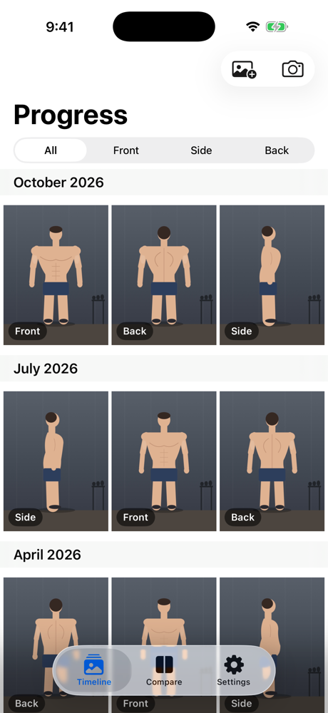
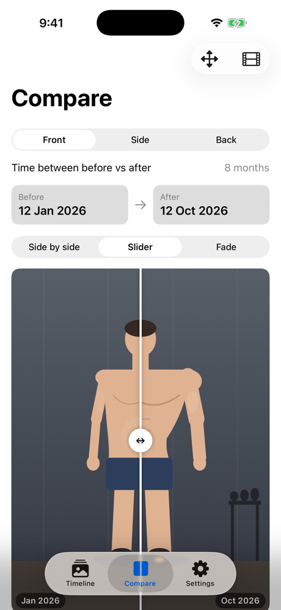
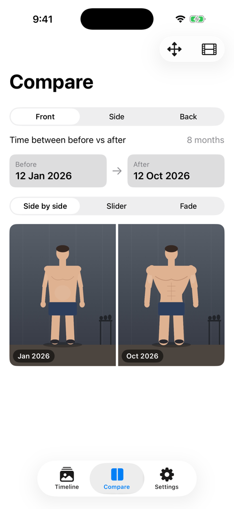
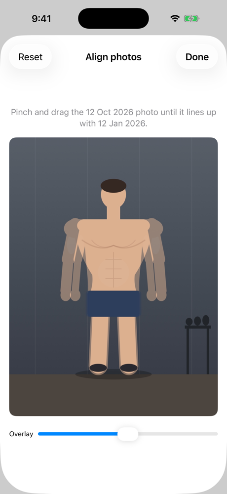
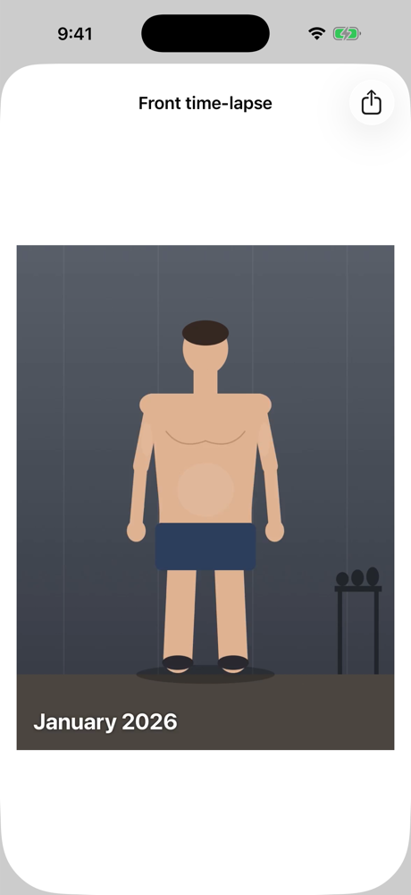
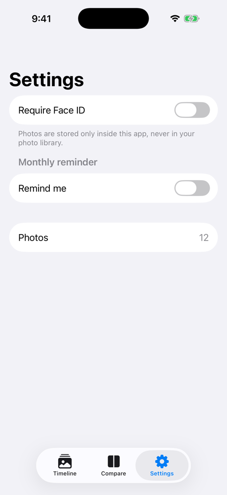

# Gym Progress

An iOS app for taking monthly gym progress photos and comparing them over time. Line up each new photo with your last one, import older shots from your library, and see the change with a before/after slider or a time-lapse.

Everything stays on your phone: no account, no server, no analytics.

<table>
  <tr>
    <td align="center"><br>Timeline</td>
    <td align="center"><br>Compare: slider</td>
    <td align="center"><br>Compare: side by side</td>
  </tr>
  <tr>
    <td align="center"><br>Align</td>
    <td align="center"><br>Time-lapse</td>
    <td align="center"><br>Settings</td>
  </tr>
</table>

<sub>Screenshots are from the iOS Simulator with illustrated demo photos, not a real person.</sub>

## Features

- **Camera with ghost overlay.** Your last photo for the same pose shows semi-transparently over the camera, so distance, angle and pose match month to month. It has a 3s/10s self-timer and moves through front → side → back in one session.
- **Import from Photos.** Pick up to 50 older photos at once. The date each photo was taken is read from its metadata and can be edited, and you tag each one as front, side or back. It uses the system photo picker, so the app never gets full access to your library.
- **Timeline.** Photos are grouped by month and can be filtered by pose. Each photo can have a date, pose, weight and notes.
- **Compare two photos.**
  - Choose any before and after photo for a pose. It defaults to your first and latest.
  - View them side by side, with a drag slider, or as a fade.
  - Shows the time between the two photos ("1 year 3 months") and the weight change when both photos have a weight.
- **Align.** Pinch and drag one photo to line it up with another. Alignment is saved per photo and used in every comparison and in the time-lapse.
- **Time-lapse.** Export every photo for a pose as an MP4 with month labels, ready to share.
- **Privacy.**
  - Photos are stored only inside the app, never in your camera roll.
  - Photos are re-encoded on save, which strips location and other metadata.
  - Files use iOS data protection.
  - Optional Face ID or passcode lock that also hides the app-switcher preview.
- **Monthly reminder.** A notification on the day and time you choose.

Your compare choices (pose, view mode, before/after picks) and settings are remembered between launches.

## Requirements

- Xcode 26 or later
- iOS 18 or later (iPhone)
- No third-party dependencies

## Running it

### In the Simulator

1. Open `GymProgress.xcodeproj` in Xcode.
2. Pick an iPhone simulator at the top of the window and press **Run** (⌘R).

If Xcode says the iOS platform isn't installed, download it from **Xcode → Settings → Components**, or run:

```bash
xcodebuild -downloadPlatform iOS
```

The Simulator has no camera, so use **Import from Photos** to try the app there.

### On your iPhone

1. Open the project, select the **GymProgress** target, then go to **Signing & Capabilities**.
2. Under **Team**, choose your Apple ID ("Add an Account…" if it isn't listed). Change the **Bundle Identifier** if Xcode says it's taken.
3. Connect your iPhone, unlock it, and select it as the run destination.
4. If prompted, turn on **Settings → Privacy & Security → Developer Mode** on the phone.
5. Press **Run**. The first time, trust your certificate on the phone in **Settings → General → VPN & Device Management**.

With a free Apple ID the installed app expires after 7 days. Run it from Xcode again to renew it; your photos are kept.

## Where data lives

| What | Where |
| --- | --- |
| Photos | JPEGs in the app's Application Support folder |
| Dates, poses, weights, notes, alignment | SwiftData store |
| Settings and compare choices | `UserDefaults` |

Data is included in normal iPhone backups. It does not sync between devices, and deleting the app deletes all of it.

## Project structure

```
GymProgress/
├── GymProgressApp.swift      App entry, Face ID lock, tab layout
├── Models.swift              ProgressPhoto model and Pose
├── PhotoStore.swift          Saving, thumbnails, metadata dates
├── PhotoViews.swift          Shared photo and badge views
├── Camera.swift              AVFoundation camera and capture screen
├── TimelineView.swift        Timeline, import review, photo details
├── CompareView.swift         Before/after compare and alignment
├── TimelapseExporter.swift   MP4 time-lapse rendering
└── SettingsView.swift        Lock and monthly reminder settings
```

The Xcode project uses a synchronized folder, so new files added to `GymProgress/` are picked up automatically.
